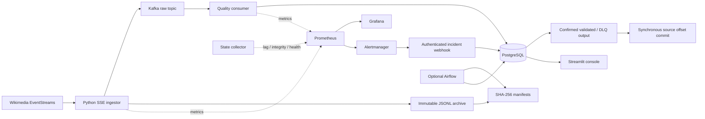

# Wikimedia Recent Changes · Data Quality & Observability

[](https://www.python.org/)
[](https://kafka.apache.org/)
[](https://www.postgresql.org/)
[](https://docs.docker.com/compose/)

[](https://prometheus.io/)
[](https://grafana.com/oss/grafana/)
[](https://streamlit.io/)
[](https://airflow.apache.org/)

[](https://github.com/NDL6704/Data-Quality-Observability-Platform-for-Wikimedia-Recent-Changes/actions)
[](https://github.com/NDL6704/Data-Quality-Observability-Platform-for-Wikimedia-Recent-Changes/actions/workflows/ci.yml)

A self-hosted streaming data platform for Wikimedia Recent Changes, built to make data
validation, delivery failures and recovery behavior explicit and verifiable.

The project ingests real events, preserves raw evidence, evaluates versioned quality rules,
and writes accepted or quarantined records to PostgreSQL. Kafka, Prometheus, Grafana,
Streamlit and optional Airflow provide messaging, observability and operator workflows.

**Delivery model:** at-least-once processing · idempotent curated writes · explicit reconciliation.

## Contents

- [Architecture](#architecture)
- [Verified results](#verified-results)
- [Data quality](#data-quality)
- [Quickstart](#quickstart)
- [Dashboards and metrics](#dashboards-and-metrics)
- [Testing and CI](#testing-and-ci)
- [Recovery and maintenance](#recovery-and-maintenance)
- [Design decisions and limitations](#design-decisions-and-limitations)
- [Repository structure](#repository-structure)

## Architecture



| Component | Technology | Responsibility |
|---|---|---|
| Ingestion | Python 3.12, HTTPX, Wikimedia SSE | Reconnects, cursor handling, original receipt timestamps and graceful shutdown |
| Messaging | Kafka 3.8, single-node KRaft | Raw, validated and dead-letter topics |
| Persistence | PostgreSQL 16, local JSONL, PyArrow | Curated data, quarantine, audit, manifests and derived Parquet |
| Observability | Prometheus, Alertmanager, Grafana OSS | Rates, latency, durable lag, probes and incident episodes |
| Operations | Streamlit, optional Airflow 2.10.5 | Investigation, explicit replay and bounded maintenance |

The recommended consumer runs on Docker's internal network. Three workers share one consumer
group and one process-local metrics registry. Each owns its Kafka client, rule engine and
connection pool; Kafka distributes the three source partitions between them.

### Commit boundary

For each consumed message, the consumer prepares one evaluation, commits its destination and
quality audit to PostgreSQL, confirms delivery to the validated/DLQ topic, and only then
synchronously commits the source offset.

No transaction spans PostgreSQL and Kafka. A crash can repeat delivery, audit entries or sink
messages. A unique event key protects curated rows; it does **not** make the pipeline exactly-once.

## Verified results

Recorded **local results from 25 October 2026**:

| Verification | Observed result |
|---|---|
| Final bounded collection | **20,000 received, Kafka-produced and archived events** |
| Collection duration | **429.48 seconds**, automatic stop at the event limit |
| Raw archive | **40 committed batches** |
| Curated growth | **20,000 rows**, from 96,952 to 116,952 |
| Final acknowledgment | All three source partitions caught up; **lag = 0** |
| Full regression after runtime hardening | **289 passed in 101.75 seconds**, live E2E enabled, no skips |
| Test breakdown | 202 unit, 53 integration, 20 recovery, 9 UI, 4 contract and 1 E2E |
| Static checks at that acceptance | Ruff clean; Mypy passed for 95 source files |

Collection duration measures ingestion, not a separately measured end-to-end throughput ceiling.
Offset catch-up was verified after collection. Subsequent layout-only changes passed nine UI
tests separately; they are not presented as another full regression run.

Reliability experiments covered process termination, database session failures, duplicate
delivery, malformed input, replay concurrency and checksum mismatches. These establish behavior
for defined scenarios, not a production SLA or long-duration capacity guarantee.

An earlier host-based single-consumer baseline completed 1,200 events at approximately 8.39
acknowledged events/second, including setup, source arrival and draining. Docker-internal
networking and three partition workers addressed the observed host-path bottleneck. That
historical number is not the capacity of the current runtime or a controlled before/after benchmark.

## Data quality

There are **11 rule IDs across six categories**: ten pre-persistence checks and one database
deduplication check. Audit records retain rule versions.

<!-- rule-catalog:start -->
| Rule ID | Version | Category | Contract |
|---|---|---|---|
| `R-SCH-01` | `1.1.0` | Schema | Parseable JSON object, finite values and storage-compatible input |
| `R-SCH-02` | `1.1.0` | Schema | Typed envelope with required meta, type and wiki fields |
| `R-CMP-01` | `1.1.0` | Completeness | Nonblank wiki and server identity |
| `R-CMP-02` | `1.1.0` | Completeness | Title availability for applicable event types |
| `R-VAL-01` | `1.1.0` | Validity | Explicit timestamp timezone and UTC normalization |
| `R-VAL-02` | `1.1.0` | Validity | Optional byte-length values fit PostgreSQL integer bounds |
| `R-VAL-03` | `1.1.0` | Validity | Namespace type and allowed range |
| `R-DED-01` | `1.1.0` | Deduplication | Stable identity with warnings for weaker fallback keys |
| `R-DED-02` | `1.1.0` | Deduplication | Duplicate delivery detected through curated unique-key conflict |
| `R-FRS-01` | `1.2.0` | Freshness | Original receipt minus source timestamp stays within configured bounds |
| `R-DRF-01` | `1.1.0` | Drift | Unknown change types in a bounded worker-local observation window |
<!-- rule-catalog:end -->

**CRITICAL/HIGH** failures quarantine input. **MEDIUM/INFO** observations can accompany accepted
records. A failed `R-DED-02` check means `INFO_DUPLICATE_DELIVERY`, not another duplicate curated row.

Freshness accepts **−2 to +300 seconds** by default. `QUALITY_MAX_FUTURE_SKEW_SECONDS` allows an
integer tolerance from 0 to 5 seconds. Correct large host clock offsets instead of concealing
them through relaxed rules. Historical receipts and audit results remain unchanged.

JSONL archives have SHA-256 manifests. Compaction creates separate Snappy Parquet files and
lineage while retaining originals. Reconciliation compares identity sets and integrity;
raw and curated counts are not assumed to be identical.

## Quickstart

### Requirements

Python **3.12**, Git, Docker Desktop with Linux containers/WSL 2, Docker Compose and internet
access. Budget disk space for images, Kafka, PostgreSQL, archives and monitoring history.
No paid cloud service is required. Commands below use **Windows PowerShell**, from the repository root.

### 1. Install and configure

```powershell
python -m venv .venv
.venv\Scripts\python -m pip install -e ".[dev,dashboard]"
if (!(Test-Path .env)) { Copy-Item .env.example .env }
```

Review [.env.example](.env.example). Host processes default to `localhost:9092` and
`localhost:5432`; the consumer container uses `kafka:29092` and `postgres:5432`.
Keep the webhook token aligned with Alertmanager configuration. Never commit `.env` or credentials.

### 2. Start infrastructure

```powershell
docker compose up -d
docker compose ps
.venv\Scripts\python -m src.storage.migration_runner
docker compose --profile monitoring up -d
docker compose --profile runtime up -d --build quality-consumer
```

Wait for Kafka/PostgreSQL health before migrations. Existing database volumes retain their
initialized credentials; editing Compose defaults does not reset them.

### 3. Start the operator services

Run each command in a separate terminal:

```powershell
.venv\Scripts\python -m src.observability.service
```

```powershell
.venv\Scripts\python -m streamlit run dashboards/streamlit/app.py --server.address 127.0.0.1
```

### 4. Collect a bounded workload

```powershell
Get-PSDrive -PSProvider FileSystem
docker system df
.venv\Scripts\python -m src.ingestion.run_ingestor --max-events 2000 --duration 60
```

The ingestor stops at the event or duration limit during stream processing. Network retries and
shutdown can add time. The standard CLI has **no automatic disk-space guard**; larger runs need
explicit disk monitoring. The consumer remains available to drain after ingestion stops.

For a host-only consumer, run the following **instead of** the consumer container:

```powershell
.venv\Scripts\python -m src.processing.consumer --workers 1
```

Avoid accidentally running both. Worker counts are limited to 1–3; exact `--max-messages` runs
require one worker.

### 5. Inspect and stop

| Interface | Address |
|---|---|
| Streamlit | [localhost:8501](http://127.0.0.1:8501) |
| Grafana dashboard | [localhost:3000](http://127.0.0.1:3000/d/wikimedia-pipeline/wikimedia-pipeline-overview?from=now-15m&to=now&refresh=5s) |
| Prometheus targets | [localhost:9090/targets](http://127.0.0.1:9090/targets) |
| Alertmanager | [localhost:9093](http://127.0.0.1:9093) |

Stop the **ingestor first**, leave consumer/collector running until lag reaches zero, then stop
them. Use Ctrl+C for host processes and `docker compose --profile runtime stop quality-consumer`
for the container. `docker compose stop` preserves volumes. Do not use `down -v` as routine
cleanup: it can remove persisted state. Consumer logs are capped at three 10 MB files; that
does not bound broker, database, archive or metrics storage.

## Dashboards and metrics

Streamlit provides compact tabs and expandable details. It supports investigation; it is not
an independent benchmark or the sole proof of pipeline correctness.

| View | Purpose and actions |
|---|---|
| Reliability & lag | Destination totals, target health, backlog/rate charts and wiki distribution |
| Quality explorer | Rule/version filters, weighted trends, explicit time filters and event lookup |
| Event inspector | Exact-key inspection of normalized data, original payload and rule audit |
| Quarantine & replay | Rejection evidence, current-policy preview and explicitly confirmed replay |
| Incident console | Episode/status charts, timeline, investigation notes and OPEN → INVESTIGATING |

Important interpretation rules:

- **Curated events** is the stored total, not the current run count.
- **Rule checks** counts evaluations. One accepted delivery normally generates eleven checks;
  re-evaluation adds observations, while invalid input can stop dependent checks early.
- Failure rates use `SUM(rows_failed) / SUM(rows_checked)`, grouped by version, never added across
  versions. Current failed-check totals include INFO-level duplicate observations.
- The normal window filters **evaluation time**. Original-receipt filtering is freshness-only;
  other rule results do not retain the same receipt metadata.
- Views are refresh-driven snapshots with bounded result lists; mutation forms are not auto-polled.

The monitoring stack includes **22 application metric families, 16 Grafana panels and 8 alert rules**.
Metrics reset on process restart. The collector reads durable committed offsets and broker
watermarks without consuming or acknowledging source records.

For empty Grafana panels, check Prometheus targets first: ingestor **8000**, consumer **8001**,
collector/webhook **8002**. Monitoring containers do not start host exporters. Finite ingestion
intentionally stops its exporter. Rate charts need multiple scrapes and a suitable time window.

## Testing and CI

### Offline checks

```powershell
.venv\Scripts\ruff check .
.venv\Scripts\mypy .
.venv\Scripts\python -m pytest tests/unit tests/contract -q
```

### Full local regression

Requires healthy Kafka/PostgreSQL and applied migrations. The integration suite includes a live
Wikimedia ingestion test, so network availability affects reproducibility.

```powershell
$env:RUN_LIVE_E2E = "1"
.venv\Scripts\python -m pytest -q
Remove-Item Env:RUN_LIVE_E2E
```

### Standalone pipeline verification

```powershell
.venv\Scripts\python -m scripts.verify_pipeline --count 100 --timeout 120
```

This uses real Wikimedia input, isolated Kafka resources and the production quality path. Checks
cover input/archive delivery, checksum/size, DB identity coverage, sink output, source acknowledgment
and metrics. Reports are generated under `data/pipeline_runs/<UUID>/`. Live DB/archive evidence
remains. Successful runs remove their Kafka resources; failed runs retain them for investigation.

### GitHub Actions

[The workflow](.github/workflows/ci.yml) runs Python 3.12 on Ubuntu for pushes, pull requests and
manual dispatch, with two independent jobs:

| Job | Scope | Artifact |
|---|---|---|
| `checks` | Ruff, Mypy and 206 offline unit/contract tests | `test-results` |
| `Kafka and PostgreSQL integration` | Real Kafka 3.8 KRaft/PostgreSQL 16, migrations and 46 integration/recovery tests | `integration-evidence` |

The integration job starts fresh containers, waits for health checks and applies migrations.
It verifies accepted/DLQ routing, curated deduplication, transaction rollback, offset handling
after failures, redelivery and concurrent quarantine replay. Fixtures are deterministic;
the source starts at Kafka rather than the live Wikimedia SSE endpoint. Boundary failures
are injected exceptions, rather than the full process-kill fault suite.

JUnit, container status and service logs are uploaded before ephemeral CI services and volumes
are removed. This job does not start dashboards, Airflow or the monitoring stack and does not
measure sustained capacity. The cleanup applies only to the temporary GitHub runner.

Hosted CI has passed on Ubuntu with Python 3.12: Ruff, Mypy, 206 offline unit/contract tests
and 46 tests against real Kafka/PostgreSQL. See the
[verified run](https://github.com/NDL6704/Data-Quality-Observability-Platform-for-Wikimedia-Recent-Changes/actions/runs/40263781513)
and download its `test-results` and `integration-evidence` artifacts. This scope is separate from the full local
pipeline acceptance results above. To follow future runs, open **Actions → quality → checks**
and expand each step for its logs. Select **Kafka and PostgreSQL integration** to inspect the
service and integration steps; its artifact contains JUnit and diagnostics. GitHub-hosted runs
continue independently of the local PC.

Automated CD is not implemented. Dependencies use ranges rather than a frozen lock. Host Mypy excludes
Airflow DAG files; their runtime verification is separate.

### Controlled load and live soak

Recorded controlled-load result on a 4-logical-CPU GitHub runner (Python 3.12.15):

| Measure | Result |
|---|---:|
| Input deliveries / source duration | 20,000 / 200.02 seconds |
| Observed source rate | 99.99 deliveries/second |
| Unique keys / duplicate deliveries | 18,000 / 2,000 |
| Unique curated / expected quarantined | 17,000 / 1,000 |
| Confirmed sink deliveries / final lag | 20,000 / 0 |
| Maximum five-second sampled lag | 92 records |
| Worker errors / retries | 0 / 0 |
| Archive manifests / checksum verification | 40 / all passed |

The [verified load run](https://github.com/NDL6704/Data-Quality-Observability-Platform-for-Wikimedia-Recent-Changes/actions/runs/40265855443)
passed all 11 reconciliation checks. Mean receipt-to-DB latency was 19.44 ms; process RSS
after the first minute ranged from 69.29–69.43 MiB during source processing. Reconciliation
allocations occur afterwards. These measurements show keeping up with this offered rate,
not maximum throughput or proof of leak-free indefinite operation.

A separate live Wikimedia soak on the local Docker internal network recorded:

| Measure | Result |
|---|---:|
| Received / processed / confirmed sink deliveries | 35,959 / 35,959 / 35,959 |
| Source duration / observed arrival rate | 900.58 seconds / 39.93 per second |
| Unique curated / quarantined / duplicate deliveries | 35,959 / 0 / 0 |
| Archive manifests / checksum verification | 72 / all passed |
| Final lag / maximum five-second sampled lag | 0 / 22 records |
| Worker errors / retries | 0 / 0 |
| Mean receipt-to-DB latency | 44.20 ms |
| Process RSS after first minute, during source processing | 74.59–75.95 MiB |

All nine live reconciliation checks passed. The SSE server closed one connection mid-stream;
the client retried and returned to HTTP 200 approximately two seconds later. Every event
received by the application was reconciled; this does not prove completeness of all upstream
Wikimedia events during the disconnect. The source and all run-owned consumers stopped after
the bounded run.
The local runtime and GitHub runner have different resources; their rates are not a controlled
hardware comparison. A 15-minute soak does not establish multi-hour/day stability.

The separate [controlled-load workflow](.github/workflows/load.yml) offers 20,000 synthetic
deliveries at 100/second: 10% repeated deliveries and 5% missing-identity inputs. Three workers
consume three partitions. It can be started from **Actions → controlled-load → Run workflow**;
changes to the verifier/workflow also trigger it. It is separate from the fast per-commit checks.

`controlled-load-evidence` contains the report, five-second lag/RSS/CPU/disk samples, raw
archives with manifests, metrics and service diagnostics. Final checks independently reconcile
archive integrity, unique DB key coverage, every sink source partition/offset and durable
acknowledgments. Rejected fixture inputs are expected, and do not mean the workload failed.

For a bounded live Wikimedia soak on the Docker internal network, after the quickstart:

```powershell
docker compose build quality-consumer
docker compose run --rm --no-deps -T -v ./data:/workspace/data quality-consumer `
    python -m scripts.verify_sustained --mode live --seconds 900 --count 60000 --drain 180
```

This uses UUID topics/groups without resetting operational offsets or existing records.
It stops ingestion before waiting for consumers
to drain. The verifier guards free space on its data filesystem; monitor the host Docker disk
separately as well. Successful runs delete only their UUID Kafka resources; failed runs retain
them for investigation. Reconciliation and network shutdown add time beyond the source limit.

These are bounded experiments at the recorded input rate and duration. RSS is process memory,
not total Docker memory; sampling and a short soak cannot establish absence of leaks, maximum
capacity, HA or a production SLA.

## Recovery and maintenance

### Fault experiments

```powershell
.venv\Scripts\python -m src.faults.cli list
.venv\Scripts\python -m src.faults.cli run all
.venv\Scripts\python -m src.faults.cli assert <path-to-report.json>
```

Ten scoped scenarios cover stream interruption, process kills, owned DB session failures,
invalid input, duplicate delivery, backlog recovery and archive corruption. Experiments use
isolated resources; saved reports can be verified without rerunning the fault.

### Quarantine and replay

| Status | Meaning |
|---|---|
| `PENDING` | Not successfully promoted; failed re-evaluation remains pending |
| `REPLAYED` | Transactional promotion completed, including idempotent duplicate handling |
| `DISCARDED` | Reserved status; no discard action is implemented in the replay UI/backend |

Replay preserves original input/receipt, evaluates current rules and atomically updates
curated/audit/replay state. Preview writes nothing. Replay does not repair payloads, republish
Kafka output or move source offsets; an operator must explicitly confirm each action.

### Reconciliation

```powershell
.venv\Scripts\python -m src.recovery.reconciler --manifest-id <manifest-id>
```

Investigate checksum failures before treating archive content as evidence. Restore and verify;
do not change a checksum to accept altered bytes, or fabricate a newer receipt to pass freshness.

### Optional Airflow

```powershell
docker compose --profile airflow up -d --build
```

Open [localhost:8080](http://127.0.0.1:8080). Bootstrap credentials are `local-admin` /
`local-airflow`, for development only. Four DAGs start paused and can be enabled explicitly:

| DAG | Schedule | Operation |
|---|---|---|
| `dq_reconciliation` | Hourly | Bounded archive/destination reconciliation |
| `archive_compaction` | Daily | Derived Snappy Parquet with source lineage |
| `daily_quality_report` | Daily | Weighted quality aggregates |
| `retention_cleanup` | Weekly | Retention inventory; scheduled runs are dry-run |

Batches are bounded to ten manifests; compaction has a 100 MB source cap. Destructive retention
requires explicit manual configuration and was not exercised in acceptance. Container jobs can
read relative archive paths via the shared mount; absolute Windows paths require an explicit
path migration before Linux tasks can access them.

## Design decisions and limitations

| Decision | Benefit | Boundary |
|---|---|---|
| Kafka + PostgreSQL without distributed transactions | Clear commit boundaries and practical recovery | Redelivery and repeated audit/sink attempts remain possible |
| Raw evidence and integrity manifests | Investigation, replay and reconciliation | File rename and manifest commit are not atomic |
| Independent worker engines and pooled connections | Lower connection overhead, isolated state | Drift observations are worker-local |
| Docker-internal consumer networking | Avoids observed Windows host-path overhead | Local measurements do not establish production capacity |
| Optional orchestration | Core pipeline operates without Airflow | Scheduler has separate metadata and operational cost |

Known limitations:

- Single-broker local deployment; no HA, production SLA or multi-hour/day capacity proof.
- Trusted local UI and development accounts/secret settings; no public multi-user authentication
  or production secret hardening.
- Canary events are not yet separated from business quality metrics and can enter quarantine.
  They must not be interpreted as failed real edits.
- Current clock offset was corrected and verified, but persistent Windows synchronization remains
  an operational follow-up.
- Monitoring restarts can leave an old incident open if a resolution notification is lost.
  Automatic orphan reconciliation is not implemented. Manual reconciliation must verify broker/
  alert state and record an audit reason; the UI does not force-resolve episodes.
- Archives, audit rows and metrics need disk budgeting. A bounded test does not demonstrate that
  indefinite ingestion is safe on a fixed-size disk.
- Worker metrics share one process registry; there is no durable cross-process recovery aggregation.

## Repository structure

```text
.github/workflows/     Offline CI checks
src/ingestion/         SSE client, producer and raw archiver
src/processing/        Consumer, retries, worker lifecycle and acknowledgment ordering
src/quality/           Versioned rules and evaluation engine
src/storage/           PostgreSQL repositories and migration runner
src/recovery/          Replay and set-based reconciliation
src/faults/            Scoped failure experiments and evidence contracts
src/observability/     Metrics, state probes and incident lifecycle
src/maintenance/       Compaction, reporting and retention inventory
schemas/              Event schema and typed models
sql/migrations/       Versioned database changes
dashboards/           Streamlit console and provisioned Grafana dashboard
monitoring/           Prometheus/Alertmanager configuration and rule tests
dags/                 Optional Airflow workflows
docker/               Consumer and Airflow images
scripts/              Finite acceptance and runtime verification tools
tests/                Unit, contract, integration, recovery, UI and E2E tests
```
